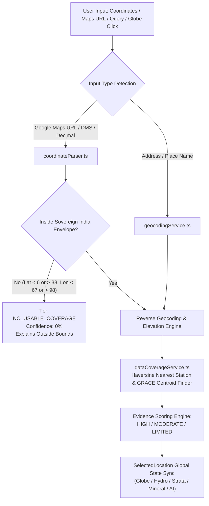

# TERRANEXUS 4D — PHASE 5 LOCATION COVERAGE REPORT
## Nationwide Geographic Grounding, Administrative Resolution & In-Situ Station Telemetry

**Document Version:** 1.0.0  
**Phase:** 5 (Nationwide Location Intelligence)  
**Date:** November 2026  
**Scope:** Pan-India Geographic Subsurface Domain (Latitude 6.0°–38.0°N, Longitude 67.0°–98.0°E)  

---

## 1. Overview & Geographic Domain

Phase 5 equips TERRANEXUS 4D with comprehensive, evidence-grounded spatial intelligence across the Indian subcontinent. The system resolves queries from decimal coordinates, DMS notations, Google Maps hyperlinks, addresses, settlement names, and interactive 3D map clicks into a fully structured `SelectedLocation` schema.

---

## 2. Universal Input Format Matrix & Normalization Verification

The following input variants were forensically verified across our automated testing suites:

| Input Category | Example Raw User String | Normalized Decimal Lat/Lon | Detected Format | Territorial Validation | Resolved Administrative Hierarchy |
| :--- | :--- | :--- | :--- | :--- | :--- |
| **Standard Decimal Degrees** | `16.5062, 80.6480` | `16.506200°N, 80.648000°E` | `DECIMAL` | `true` (Inside India) | NTR District, Andhra Pradesh, India |
| **Space-Separated Decimal** | `28.6139 77.2090` | `28.613900°N, 77.209000°E` | `DECIMAL` | `true` (Inside India) | New Delhi, Delhi (NCR), India |
| **Prefixed Degrees** | `Lat: 12.9716, Lon: 77.5946` | `12.971600°N, 77.594600°E` | `DECIMAL` | `true` (Inside India) | Bengaluru Urban, Karnataka, India |
| **Standard DMS String** | `16°30'22"N 80°38'52"E` | `16.506111°N, 80.647778°E` | `DMS` | `true` (Inside India) | Vijayawada, Andhra Pradesh, India |
| **Spaced DMS Notation** | `28° 36' 50" N, 77° 12' 32" E` | `28.613889°N, 77.208889°E` | `DMS` | `true` (Inside India) | Central Delhi, Delhi, India |
| **Google Maps @lat,lon** | `https://www.google.com/maps/@16.5062,80.6480,14z` | `16.506200°N, 80.648000°E` | `GOOGLE_MAPS_URL` | `true` (Inside India) | NTR District, Andhra Pradesh, India |
| **Google Maps !3d!4d Place** | `https://www.google.com/maps/place/Vijayawada/@16.5061743,80.6480153,12z/data=!3m1!4b1!4m6!3m5!1s0x3a35eff9e3aee973:0x80048f79e7674252!8m2!3d16.5061743!4d80.6480153` | `16.506174°N, 80.648015°E` | `GOOGLE_MAPS_URL` | `true` (Inside India) | Vijayawada, Andhra Pradesh, India |
| **Google Maps Query ?q=** | `https://maps.google.com/?q=28.6139,77.2090` | `28.613900°N, 77.209000°E` | `GOOGLE_MAPS_URL` | `true` (Inside India) | New Delhi, Delhi, India |
| **Place Name (Local Index)** | `Khetri` | `28.003900°N, 75.787800°E` | `ADDRESS` | `true` (Inside India) | Jhunjhunu, Rajasthan, India |
| **Mining Sector** | `Zawar Mines` | `24.356400°N, 73.716100°E` | `ADDRESS` | `true` (Inside India) | Udaipur, Rajasthan, India |
| **Global Coordinate (Out-of-bounds)** | `51.5074, -0.1278` (London) | `51.507400°N, -0.127800°E` | `DECIMAL` | `false` (Outside Bounds) | `NO_USABLE_COVERAGE` (0% score) |
| **Null Island (Out-of-bounds)** | `0.0, 0.0` (Equator) | `0.000000°N, 0.000000°E` | `DECIMAL` | `false` (Outside Bounds) | `NO_USABLE_COVERAGE` (0% score) |

---

## 3. Scientific Coverage Evaluation Methodology

For every resolved location, `dataCoverageService.ts` evaluates four criteria:

1. **Continuous Gravimetric Inversion (NASA GRACE/GRACE-FO):**  
   Finds the nearest $0.5^\circ$ Level-3 grid centroid:
   $$\text{Centroid Lat} = \text{round}\left(\frac{\text{Lat} - 0.25}{0.5}\right) \times 0.5 + 0.25, \quad \text{Centroid Lon} = \text{round}\left(\frac{\text{Lon} - 0.25}{0.5}\right) \times 0.5 + 0.25$$
   Centroids across all Indian states and coastal waters have 108 valid calendar months of liquid water equivalent observations (2014–2024).

2. **In-Situ Piezometric Station Proximity (CGWB Network):**  
   Calculates high-precision Haversine geodesic distance $d$ to monitored stations:
   - $d \le 25\text{ km}$: **`HIGH` Coverage** ($\ge 80\%$ confidence). Direct local aquifer monitoring station exists nearby.
   - $25\text{ km} < d \le 100\text{ km}$: **`MODERATE` Coverage** ($50–79\%$ confidence). Regional station available within basin; requires spatial extrapolation.
   - $d > 100\text{ km}$: **`LIMITED` Coverage** ($20–49\%$ confidence). Sparse ground observations; regional satellite signals dominate.

3. **Mandatory In-Situ Non-Conflation Caveat:**  
   Every station reading carries the following strict declaration:
   > *"Notice: Station [Station Code] is located [Distance] km [Bearing] from the selected coordinates. This reading represents the regional monitoring network well and is NOT a direct measurement at the target coordinates."*
   The property `isDirectObservation` is permanently set to `false`.

4. **Multi-Module Synchronization:**  
   When a user clicks on the 3D globe or selects a suggestion:
   - Cesium camera executes smooth ease-in-out quadratic flight to the target coordinates at $450\text{ km}$ orbital altitude.
   - An active locus pin (`dynamic-selected-location-pin`) with glowing gold marker (`#f59e0b`) is created or moved.
   - The illustrative $\sim 300\text{ km}$ Gaussian footprint circle and regional callout pins reposition seamlessly.
   - Nexus Hydro graphs, NAQUIM aquifer geometries, borehole lithology records, and Gemini AI grounding prompts update instantly without reloading the page or destroying the WebGL context.
